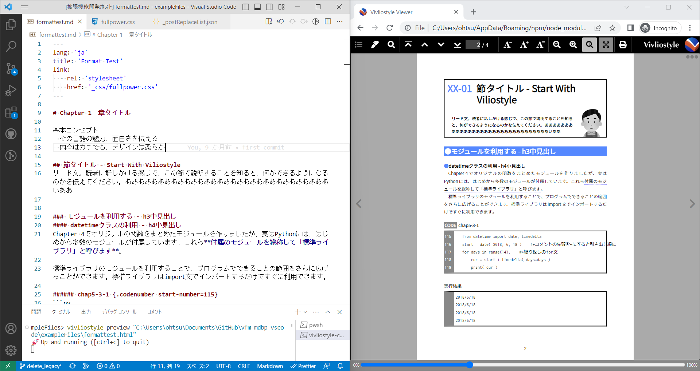
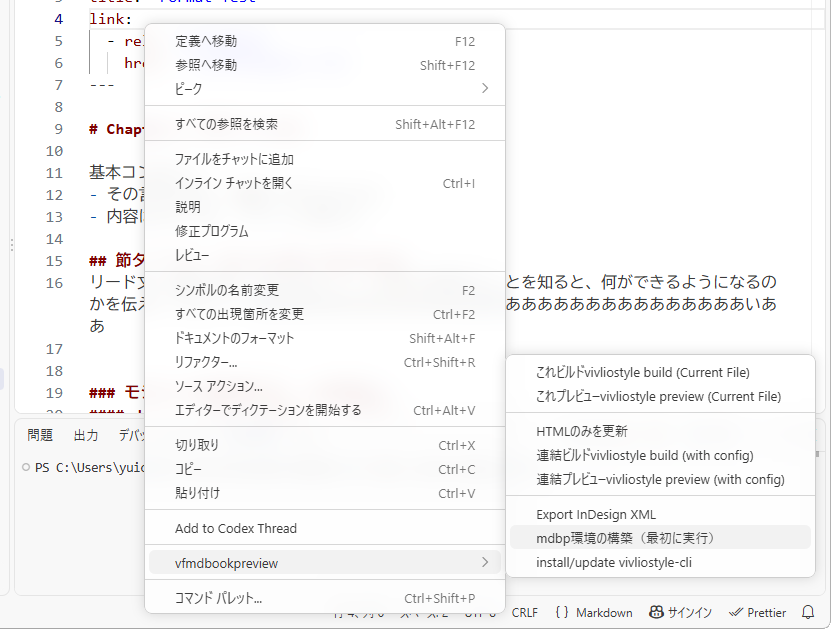

# vfm-mdbp-vscode README
MDBP（MarkDown-Book-Preview）は書籍の原稿作成に適したMarkdownプレビューの機能拡張です。 [Vivliostyle](https://vivliostyle.org/download/)と組み合わせて書籍の体裁で表示し、原稿データをInDesign向けのXMLファイルとして書き出す機能を持ちます。

[『Web技術で「本」が作れるCSS組版 Vivliostyle入門』（リブロワークス著，Vivliostyle監修，C&R研究所2023年5月刊）](https://www.c-r.com/book/detail/1493)のために作成した，vivliosytle-cli-helperに，独自機能を盛り込んだものです。

## Features
- 組版用CSSによって書籍のリアルタイムプレビュー，PDF書き出しを行える
- 置換リストを使用してHTML変換後にテキスト置換を行える。これはMarkdownの不足を補うために使用する
- 画像ファイル名にsvgimgという拡張指定を追加すると、スクリーンショットの拡大縮小やトリミングが行える
- 簡易的にソースコードに行番号を振る機能を加えている
- Adobe InDesignの構造ウィンドウで読み込み可能なXMLファイルを書き出せる





## 事前準備
1. Vivliostyle CLIの実行に必要なNode.js 22以上をインストールしてください。<br>
[Node.js日本語ページ](https://nodejs.org/ja)


2. ターミナルから以下のコマンドを実行してVivliostyle CLIの最新版をインストールします。これはMDBPの右クリックメニューからも実行できます。

```
npm install -g @vivliostyle/cli
```

## 基本的な使い方
1. VSCodeでフォルダーを開いてください。そこがWebサーバーのルートになります。
2. Markdownを開いて右クリックし、［mdbp環境の構築（最初に実行）］を実行します。依存パッケージのインストール完了後に［これプレビューvivliostyle preview (Current File)］を実行します。
3. 原稿を保存するとCLI側でプレビューが更新されます。置換JSON・DOM操作JSON・svgimg画像の寸法を変更した場合は、プレビューを再起動してください。
4. プレビューを停止したい場合は，VSCodeのターミナルをクリックして，Ctrl + C（macOSはcontrol + C）キーを押します。
5. 読み込むCSSファイルを指定するには、Markdownファイルの先頭にFrontmatterを書きます。

##### Frontmatterの例
```md
---
lang: 'ja'
link:
  - rel: 'stylesheet'
    href: '_css/fullpower.css'
---
```

この動作はVFM（Vivliostyle Fravored Markdown）の仕様に基づくものです。詳しくは解説ページを参照してください。

https://vivliostyle.github.io/vfm/#/vfm#frontmatter

https://vivliostyle.github.io/vfm/#/ja/vfm

https://github.com/vivliostyle/vfm


## コマンド解説
### Mermaidの図版

`mermaid`コードブロックは、プレビュー・HTML出力・PDF生成時にインラインSVGへ変換します。

````md

````

Mermaidが含まれる原稿だけ描画用ブラウザーを起動します。初回セットアップではMermaid CLIとそのブラウザーもインストールするため、時間がかかることがあります。変換できない図は警告を出し、元のコードブロックを残します。

以前生成したプロジェクトで使う場合は、拡張の`cli-runtime/`内の`document-processor.cjs`、`mermaid-transformer.cjs`、`package.json`をプロジェクトの`.mdbp-cli/`へコピーし、プロジェクトのルートで`npm.cmd install --prefix .mdbp-cli`（macOSでは`npm install --prefix .mdbp-cli`）を実行してください。設定ファイルの章順は維持できます。

### ▶［これビルドvivliostyle build (Current File)］
現在エディタで開いているMarkdownまたはHTMLファイルをもとに，Vivliostyleを使ってPDFを書き出します。Markdownファイルの拡張子を変えたPDFが，同じ階層に書き出されます。

プレビューを実行している場合は，いったんCtrl + C（macOSはcontrol + C）キーで中止してください。

### ▶［これプレビューvivliostyle preview (Current File)］
現在エディタで開いているMarkdownまたはHTMLファイルをもとに，Vivliostyleを使って紙面のプレビューを表示します。

### ▶［mdbp環境の構築（最初に実行）］

Markdownを開いて実行すると、ワークスペースのルート（フォルダーを開いていない場合は原稿のフォルダー）に設定を生成します。
`entry`の初期値は現在のMarkdownです。章の追加と順番は`entry`だけで指定します。

既存の`vivliostyle.config.js`がある場合は上書きするか確認します。上書きしない場合も設定ファイルは維持したまま、`.mdbp-cli/`の生成と依存パッケージのインストールを実行します。

変換モジュールと専用の依存パッケージ定義を`.mdbp-cli/`へ生成し、バックグラウンドでインストールします。
`.gitignore`が存在する場合は、MDBPの生成物を除外する行を不足分だけ追記します。
進行状況を表示し、完了後に設定を開いて「プレビューを開始」を選べます。失敗した場合はログを表示し、再試行できます。
Windowsでは`cmd.exe`から`npm.cmd`を実行するため、PowerShellの実行ポリシー変更は不要です。
プレビュー／ビルドはNode.jsからローカルCLIを直接起動し、依存パッケージが未導入なら先にインストールします。
生成環境はCLI 11.2.0、VFM 2.7.2を使用します。CLI v8はこの経路の対象外です。

MDBPなしで実行する場合も、プロジェクトのルートで次のコマンドを使用できます。

```sh
npm install --prefix .mdbp-cli
npm exec --prefix .mdbp-cli -- vivliostyle preview --config vivliostyle.config.js
npm exec --prefix .mdbp-cli -- vivliostyle build --config vivliostyle.config.js
```

設定と`.mdbp-cli/`内のソース・package.json・package-lock.jsonは原稿と一緒に管理してください。
`.mdbp-cli/node_modules/`、`.mdbp-cli/current-*.cjs`、`.vivliostyle/`、`.vivliostyle-current/`は生成物です。

### ▶［連結ビルド／連結プレビュー (with config)］

現在のファイルのフォルダーからワークスペースのルートまで上に探した`vivliostyle.config.js`を使用します。
`entry`に指定したMarkdownをCLIが変換し、svgimg、置換、連番、行番号などの独自処理も適用します。
既存の手書き設定も実行できますが、独自処理を使う場合は`documentProcessor`の指定が必要です。
`vivliostyle.mdbplist.json`による一覧指定は廃止しました。

### 現在のファイルのプレビュー／ビルド

設定生成で作成した`.mdbp-cli/`の変換モジュールを使用します。
現在のMarkdownまたはHTMLだけを対象にした実行用設定を生成し、CLIを起動します。
書籍用設定の`entry`は変更しません。PDFは原稿と同じフォルダーに生成します。
単体実行用の設定と作業フォルダーは原稿パスのハッシュで識別し、同じ原稿では再利用します。
別原稿のプレビューとは分離します。以前のバージョンが生成したUUID形式の設定・作業フォルダーは、
プレビュー停止後に必要に応じて手動で削除できます。

実行前に設定ファイルと変換モジュールを確認し、不足していれば設定生成を案内します。
手書き設定だけを使う連結実行も利用できます。WindowsのPowerShellだけ`.cmd`を使用し、macOSでは`npm`を使用します。

実行前に対象原稿を保存します。連結実行では対象ワークスペース内の変更を保存します。
保存時にMDBPがHTMLを自動生成する処理は廃止しました。原稿の更新はCLIのプレビューが扱います。
「HTMLのみ更新」とMarkdownからのXML出力も、同じプロジェクト側変換モジュールをCLIから実行します。
設定生成と依存パッケージのインストールが必要です。HTMLは原稿と同じフォルダーへ出力します。
HTML生成の完了後にブラウザーを開くか、既存のXML変換器でXMLを生成します。
HTMLファイルからXMLを出力する場合は、保存したHTMLを直接使用します。
拡張機能内部の旧Markdown変換器とVFM依存は削除済みです。VFMはプロジェクト側の`.mdbp-cli/`だけで使用します。
このリポジトリーの`exampleFiles/vivliostyle.config.js`を直接使う場合は、先にルートで`npm install --prefix cli-runtime`を実行してください。
### ▶［Export InDesign XML］
InDesignの［構造］パネルで読み込み可能なXMLファイルを書き出します。

### ▶［install/update vivliostyle-cli］
Vivliostyle CLI最新版のインストールを行います。ターミナルから以下のコマンドを実行するのに相当します。

```
npm install -g @vivliostyle/cli
```


## その他の機能
### 置換リスト
置換リストは`_postReplaceList.json`というJSONファイル内に記述します。

以下の置換リストは「@div クラス名」と「@divend」で囲んだ範囲を、div要素に置換します。また、ハイフンで生成する水平線は改ページ指定として処理します。
```
[
    {
        "f": "@div:([a-z|0-9 ]+)",
        "r": "<div class=\"$1\">"
    },
    {
        "f": "@divend",
        "r": "<\/div>"
    },
    {
        "f": "<hr>",
        "r": "<hr class=\"pagebreak\">"
    },
……後略……
```
サンプル置換リスト

https://gist.github.com/lwohtsu/7abb3f9e1a1c8e06b600f8ef915a10e7

### 画像のトリミング
IT書でスクリーンショットは欠かせません。いちいちグラフィックスソフトでトリミングしたり、拡大縮小率を厳密に指定するのは手間なので、画像ファイル名のあとに簡単な指示を入れることで、指定できるようにしました。

```


?svgimg=倍率,横幅mm,高さmm,横シフト量mm,縦シフト量mm
```

倍率以外のパラメータは省略可能です。幅と高さは省略時なりゆき、シフト量は0となります。

`svgimg`で処理できるのはローカルのBMP、GIF、JPEG、PNG、SVG、TIFF、WebP画像です。倍率には0より大きい数値、幅と高さには0以上の数値を指定してください。画像が存在しない、破損している、パラメータが不正といった場合は警告を表示し、その画像のMarkdown記法を変更せずに残して文書全体の変換を継続します。

### その他
ゲタ文字〓を使用して連番を自動生成できます。

### postManipulate（後操作）機能
Markdownの記述を簡単にするために、デザイン都合でHTML構造を自動変更する機能を追加しました。h2見出しと直後のp要素を、装飾用の\<div:secheader\>～\</div\>で囲むといった操作を行えます。jQueryに似た機能を持つcheerioというライブラリを利用しています。

操作内容は_postManipurate.jsonというファイルに「セレクタ」「メソッド」「パラメータ」を指定する形にしているので、プロジェクトごとに設定変更が可能です。
```
[
  {
    "selector": "h1",
    "method": "wrapWithNextSib",  // h1要素とその次の1要素をdiv.coverpageでラップする（見出しとリード文のグループ化）
    "paramator": "<div class=\"coverpage\"></div>"
  },
  {
    "selector": "h2",
    "method": "wrap",     // h2要素をdiv.secheaderでラップする（h2要素に装飾用のdivを追加）
    "paramator": "<div class=\"secheader\"></div>"
  },
    "selector": "h3",
    "method": "wrapAll",  // h3要素の直後にある複数のp要素をすべてdiv.col2でラップする（見出しの下の段落を2段組みに）
    "paramator": ["p", "<div class=\"col2\"></div>"]
  },
  {
    "selector": "h2",
    "method": "dupRunning",  // h2要素のテキストを複製してspan.header2という要素を作成する（柱テキストの作成）
    "paramator": "<span class=\"header2\"></span>"
  },
    "selector": "p code",
    "method": "addClass",  // p要素内のcode要素にinline_codeというクラスを追加する
    "paramator": "inline_code"
  },
]
```

### ソースコードに行番号を付ける機能
コードの前に次の形式で書くと、直後のpre &gt; code内を改行コードで分割し、`<span class="codenum-elem">000</span>`を追加する。
```
###### sampe1.html {.codenumber start-number=15}
`` `
コード
コード
コード
`` `
```


## Requirements
- VSCode 1.100.0以上
- Node.js v20以上


## Release Notes
### 0.4.0
今回はCodexでコードの大幅な整理を行った。
- `@vivliostyle/vfm`を最新版へ更新し、依存パッケージを整理
- InDesign XMLを書き出す際のコード内の空白を保持し、段落要素間の改行と`story > body`構造に対応
- `svgimg`で画像が存在しない場合などの例外処理を改善
- 保存文書の直接変換、重複処理の整理、メッセージ表示の統一
- ワークスペースを開いていない場合（単独ファイルを開いた場合）や作業ルートが複数ある場合に、Markdownファイルのフォルダを作業ルートと判定する

### 0.3.0（0.2.10）
VFM2.5にアップデート

### 0.3.0（0.2.10）
HTMLだけを更新する機能を追加（VFMだけ使用）

### 0.2.9
暫定処理として8.xより上がインストールされないよう固定

### 0.2.8
vfmを2.2.1にアップデート


### 0.2.7
コミットし忘れ対応


### 0.2.6
VFMを2.2.0にアップデート

non-sectionized見出しに対応
```
#### sectionized見出し
テキスト

####    <!--同じ数の#の行を書くと、ここでセクションを終了できる-->


#### non-sectioneze見出し{.クラス} ####　<!--末尾に同じ数の#を書くと、セクションを生成しない-->
```


### 0.2.5
書き出したXMLのインデントを削除


### 0.2.4
XML書き出し時のクラス名のバグを修正


### 0.2.3
画像のリンク切れ時にメッセージを表示するよう改良

連結プレビュー，連結ビルドを実装

### 0.2.2
ドキュメントが更新できていなかったので，マイナーアップデート。

### 0.2.0
大幅変更。vivliostyle CLIに依存する形に変更し，独自のLive Serverを削除。
機能をシンプルにするよう調整。ひとまず「これプレビュー」など最低限の機能を使えるように実装。

連結プレビュー，連結ビルド機能は実装中。


### 0.1.11
VFMを2.1.0にアップデートし、連番機能を修正

### 0.1.10
空のp要素をムリヤリ削除する処理を追加。
### 0.1.9
CLIからPDFを出力する際に、原稿のファイル名をPDFファイル名に使用する


### 0.1.8
実験的なソースコードの連番機能。


### 0.1.7
コマンドパレットでオリジナルのMDBPと混同しないようコマンドのカテゴリ名を変更

### 0.1.6
Vivliostyle CLIを利用したPDF書き出しを追加

### 0.1.5
プレビュー更新をmdbp-vscode 0.1.5に合わせて修正

### 0.1.0
最初のリリース

-----------------------------------------------------------------------------------------------------------

(c)libroworks.co.jp
http://libroworks.co.jp/
