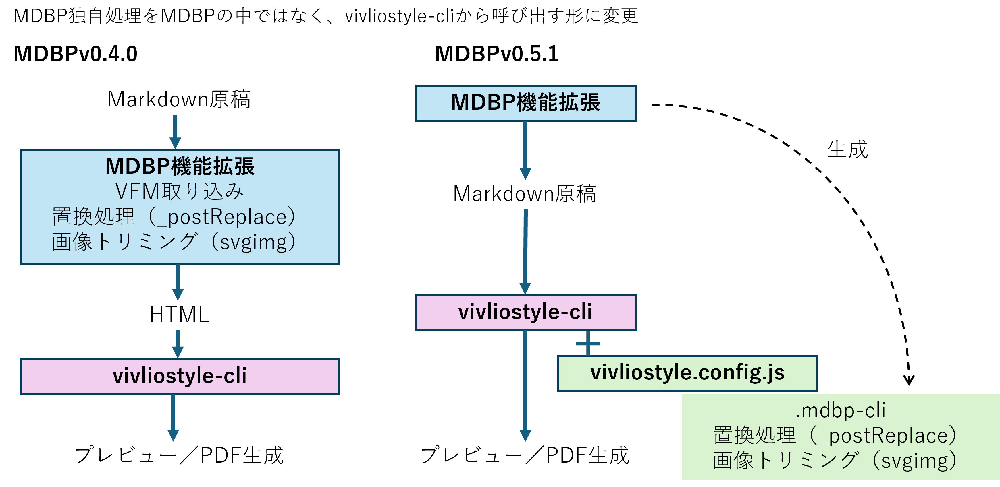
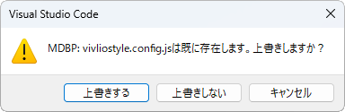
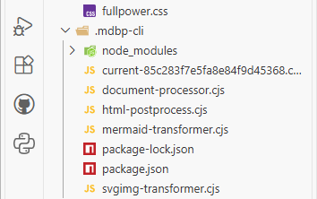
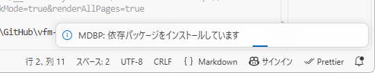

# vfm-mdbp-vscode README
MDBP（MarkDown-Book-Preview）は書籍の原稿作成に適したMarkdownプレビューの機能拡張です。 [Vivliostyle](https://vivliostyle.org/download/)と組み合わせて書籍の体裁で表示し、原稿データをInDesign向けのXMLファイルとして書き出す機能を持ちます。

[『Web技術で「本」が作れるCSS組版 Vivliostyle入門』（リブロワークス著，Vivliostyle監修，C&R研究所2023年5月刊）](https://www.c-r.com/book/detail/1493)のために作成したvivliosytle-cli-helperに独自機能を盛り込んだものです。

v0.5.x以降を初めて使用する場合は、以降の「v0.5.x以降の大幅変更について」を参照してください。

## Features
- 組版用CSSによって書籍のリアルタイムプレビュー，PDF書き出しを行える
- 置換リストを使用してHTML変換後にテキスト置換を行える。これはMarkdownの不足を補うために使用する
- 画像ファイル名にsvgimgという拡張指定を追加すると、スクリーンショットの拡大縮小やトリミングが行える
- 簡易的にソースコードに行番号を振る機能を加えている
- Adobe InDesignの構造ウィンドウで読み込み可能なXMLファイルを書き出せる


## v0.5.x以降の大幅変更について
これまでMDBP内部で行っていた独自処理（置換処理、画像トリミング処理など）を、大部分vivliostyle-cli標準のviviliostyle.confing.jsに外出しする構造に変更しました。



これにより次のようなメリットが得られます。

- 標準仕様に沿った使い方に近づけたため、MDBPがない状態でも、vivliostyle-cliのコマンドのみでビルド（vivliostyle build）やプレビュー（vivliostyle preview）が可能。
- MDBPがVFMを内包しないので、vivliostyleの更新速度に追従しやすくなった。
- 連結ビルド、連結プレビュー時は、vivliostyle.config.jsの`entry:[...]`にMDファイルを列挙するだけでよくなった（以前はMDBPが必須だったので、MDBPでHTMLを出力したのち、それを連結する手間が必要）。
- その他、全体的に細部の挙動が改善されており、原稿を書くだけでなく最後までCSSで組版する場合は新版のほうが使いやすいはずです。

その代わりに、0.5.x以降は、**プロジェクトフォルダで初めて作業する際に［mdbp環境の構築（最初に実行）］を選択**して、プロジェクトフォルダ内に必要ファイルを生成する必要があります。

このコマンドは次の処理を実行します。

- vivliostyle.config.jsがない場合は生成（ある場合は上書き確認あり）

- .media-cliフォルダに独自処理（置換処理、画像トリミング処理など）を行うためのコードファイルを書き込む

- .media-cliフォルダ内でnpm installを実行（独自処理に必要なnpmパッケージのインストールを行う）

- npmパッケージをGitHubにプッシュすると重くなるため、.gitignoreに無視する指定を追加。

###### .gitignore
```
# MDBP
.mdbp-cli/node_modules/
.mdbp-cli/current-*.cjs
.vivliostyle-current/
.vivliostyle/
```

副作用として、.mdbp-cli/node_modules内に大量のファイルが存在するため、**プロジェクトフォルダごとコピーすると非常に時間がかかります**。Git以外のクラウドストレージでやりとりする際も同様の問題が起きます。

基本的にはGitHubのリポジトリをクローン→［mdbp環境の構築］を実行するか、Markdown原稿などのファイル単位でコピーすることをおすすめします。

### 既存のプロジェクトからのアップデートについて
プロジェクト自体には互換性があります。右クリックメニューから［mdbp環境の構築］を選択して必要ファイルを生成させてください。その完了後にこれまでと同様に編集できます。


## 事前準備
1. Vivliostyle CLIの実行に必要なNode.js 24以上をインストールしてください。<br>
[Node.js日本語ページ](https://nodejs.org/ja)


2. ターミナルから以下のコマンドを実行してVivliostyle CLIの最新版をインストールします。これはMDBPの右クリックメニューからも実行できます。

```
npm install -g @vivliostyle/cli
```

## 基本的な使い方
1. VSCodeでフォルダーを開いてください。そこがWebサーバーのルートになります。
2. Markdownを開いて右クリックし、［mdbp環境の構築（最初に実行）］を実行します。依存パッケージのインストール完了後に［これプレビューvivliostyle preview (Current File)］を実行します。
3. 原稿を保存すると自動的にプレビューが更新されます。
4. プレビューを停止したい場合はプレビューウィンドウを閉じます。それでも終了しない場合は、VSCodeのターミナルをクリックして，Ctrl + C（macOSはcontrol + C）キーを押します。
5. 読み込むCSSファイルを指定するには、Markdownファイルの先頭にFrontmatterを書きます。

##### Frontmatterの例
```md
---
lang: 'ja'
link:
  - rel: 'stylesheet'
    href: '_css/fullpower.css'
---
```

この動作はVFM（Vivliostyle Fravored Markdown）の仕様に基づくものです。詳しくは解説ページを参照してください。

- https://vivliostyle.github.io/vfm/#/vfm#frontmatter
- https://vivliostyle.github.io/vfm/#/ja/vfm
- https://github.com/vivliostyle/vfm


## コマンド解説
### Mermaidの図版（0.5.x以降）

`mermaid`コードブロックは、プレビュー・HTML出力・PDF生成時にインラインSVGへ変換して表示します。

````md

````

Mermaidが含まれる原稿だけ描画用ブラウザーを起動します。初回セットアップではMermaid CLIとそのブラウザーもインストールするため、時間がかかることがあります。変換できない図は警告を出し、元のコードブロックを残します。


### ▶［これビルドvivliostyle build (Current File)］
現在エディタで開いているMarkdownまたはHTMLファイルをもとに，Vivliostyleを使ってPDFを書き出します。Markdownファイルの拡張子を変えたPDFが，同じ階層に書き出されます。

プレビューを実行している場合は、いったんCtrl + C（macOSはcontrol + C）キーで中止してください。

### ▶［これプレビューvivliostyle preview (Current File)］
現在エディタで開いているMarkdownまたはHTMLファイルをもとに，Vivliostyleを使って紙面のプレビューを表示します。

### ▶［mdbp環境の構築（最初に実行）］

Markdownを開いて実行すると、ワークスペースのルート（フォルダーを開いていない場合は原稿のフォルダー）に設定を生成します。
`entry`の初期値は現在のMarkdownです。章の追加と順番は`entry`だけで指定します。

既存の`vivliostyle.config.js`がある場合は上書きするか確認します。上書きしない場合も設定ファイルは維持したまま、`.mdbp-cli/`の生成と依存パッケージのインストールを実行します。

この処理を実行すると、変換モジュールと専用の依存パッケージ定義を`.mdbp-cli/`へ生成し、バックグラウンドでインストールします。
`.gitignore`が存在する場合は、MDBPの生成物の除外指定を必要に応じて追記します。

MDBPなしで特定のファイルを実行する場合も、プロジェクトのルートで次のコマンドを使用できます（この文はAIが追加したもので、おそらく実行可能ですが、めったに使う機会はないと思います）。

```sh
npm install --prefix .mdbp-cli
npm exec --prefix .mdbp-cli -- vivliostyle preview --config vivliostyle.config.js
npm exec --prefix .mdbp-cli -- vivliostyle build --config vivliostyle.config.js
```

設定と`.mdbp-cli/`内のソース・package.json・package-lock.jsonは原稿と一緒に管理してください。
`.mdbp-cli/node_modules/`、`.mdbp-cli/current-*.cjs`、`.vivliostyle/`、`.vivliostyle-current/`は生成物です。

### ▶［連結ビルド／連結プレビュー (with config)］
複数のファイルを連結してビルドまたはプレビューします。
`vivliostyle.config.js`の`entry`に指定したMarkdownをCLIが変換し、svgimg、置換、連番、行番号などの独自処理も適用します。
```
entry: ["30_genkou/chap1.md","30_genkou/chap2.md","30_genkou/chap3.md","30_genkou/chap5.md","30_genkou/chap6.md"],
```

現在のファイルのフォルダーからワークスペース（vscodeで開いているフォルダ）のルートまで上に探した`vivliostyle.config.js`を使用します。MDBP独自処理を使う必要があるため、［mdbp環境の構築］で生成した`vivliostyle.config.js`（`documentProcessor`などの指定を持つ）をベースに、原稿ファイルを付け加えることをおすめします。

v0.4.xまでに使用していた`vivliostyle.mdbplist.json`による連結指定は廃止しました。

### ▶［Export InDesign XML］
InDesignの［構造］パネルで読み込み可能なXMLファイルを書き出します。

### ▶［install/update vivliostyle-cli］
Vivliostyle CLI最新版のインストールを行います。ターミナルから以下のコマンドを実行するのに相当します。

```
npm install -g @vivliostyle/cli
```


## MDBP独自機能
### 置換リスト
置換リストは`_postReplaceList.json`というJSONファイル内に記述します。

以下の置換リストは**フェンス記法**を独自実装するためのもので、「:::{.クラス名}」と「:::」で囲んだ範囲を、div要素に置換します。また、ハイフンで生成する水平線は改ページ指定として処理します。

```
[
  {
    "f": ":{3,}\\{\\.?([a-z|0-9|\\-|_|\\s]+)\\}",
    "r": "<div class=\"$1\">"
  },
  {
    "f": ":{3,}",
    "r": "</div>"
  },
  {
    "f": "<hr>",
    "r": "<hr class=\"pagebreak\">"
  },
……後略……
```
サンプル置換リスト

https://gist.github.com/lwohtsu/7abb3f9e1a1c8e06b600f8ef915a10e7

### 画像のトリミング
IT書でスクリーンショットは欠かせません。いちいちグラフィックスソフトでトリミングしたり、拡大縮小率を厳密に指定するのは手間なので、画像ファイル名のあとに簡単な指示を入れることで、指定できるようにしました。

```


?svgimg=倍率,横幅mm,高さmm,横シフト量mm,縦シフト量mm
```

倍率以外のパラメータは省略可能です。幅と高さは省略時なりゆき、シフト量は0となります。

`svgimg`で処理できるのはローカルのBMP、GIF、JPEG、PNG、SVG、TIFF、WebP画像です。倍率には0より大きい数値、幅と高さには0以上の数値を指定してください。画像が存在しない、破損している、パラメータが不正といった場合は警告を表示し、その画像のMarkdown記法を変更せずに残して文書全体の変換を継続します。

### その他
ゲタ文字〓を使用して連番を自動生成できます。

### ソースコードに行番号を付ける機能
コードの前に次の形式で書くと、直後のpre &gt; code内を改行コードで分割し、`<span class="codenum-elem">000</span>`を追加する。
```
###### sampe1.html {.codenumber start-number=15}
`` `
コード
コード
コード
`` `
```


## Requirements
- VSCode 1.140.0以上
- Node.js v24以上


## Release Notes
### 0.5.1
Codexを使用し、MDBPの独自機能を外部に分離する改造を行った。

- ［mdbp環境の構築］機能により、プロジェクトフォルダに対し、必要ファイルのインストールを実行
- mermaid対応
- その他の基本操作は変更なし

詳細は、上の「v0.5.x以降の大幅変更について」を参照。

### 0.4.0
今回はCodexでコードの大幅な整理を行った。
- `@vivliostyle/vfm`を最新版へ更新し、依存パッケージを整理
- InDesign XMLを書き出す際のコード内の空白を保持し、段落要素間の改行と`story > body`構造に対応
- `svgimg`で画像が存在しない場合などの例外処理を改善
- 保存文書の直接変換、重複処理の整理、メッセージ表示の統一
- ワークスペースを開いていない場合（単独ファイルを開いた場合）や作業ルートが複数ある場合に、Markdownファイルのフォルダを作業ルートと判定する

### 0.3.0（0.2.10）
VFM2.5にアップデート

### 0.3.0（0.2.10）
HTMLだけを更新する機能を追加（VFMだけ使用）

### 0.2.9
暫定処理として8.xより上がインストールされないよう固定

### 0.2.8
vfmを2.2.1にアップデート


### 0.2.7
コミットし忘れ対応


### 0.2.6
VFMを2.2.0にアップデート

non-sectionized見出しに対応
```
#### sectionized見出し
テキスト

####    <!--同じ数の#の行を書くと、ここでセクションを終了できる-->


#### non-sectioneze見出し{.クラス} ####　<!--末尾に同じ数の#を書くと、セクションを生成しない-->
```


### 0.2.5
書き出したXMLのインデントを削除


### 0.2.4
XML書き出し時のクラス名のバグを修正


### 0.2.3
画像のリンク切れ時にメッセージを表示するよう改良

連結プレビュー，連結ビルドを実装

### 0.2.2
ドキュメントが更新できていなかったので，マイナーアップデート。

### 0.2.0
大幅変更。vivliostyle CLIに依存する形に変更し，独自のLive Serverを削除。
機能をシンプルにするよう調整。ひとまず「これプレビュー」など最低限の機能を使えるように実装。

連結プレビュー，連結ビルド機能は実装中。


### 0.1.11
VFMを2.1.0にアップデートし、連番機能を修正

### 0.1.10
空のp要素をムリヤリ削除する処理を追加。
### 0.1.9
CLIからPDFを出力する際に、原稿のファイル名をPDFファイル名に使用する


### 0.1.8
実験的なソースコードの連番機能。


### 0.1.7
コマンドパレットでオリジナルのMDBPと混同しないようコマンドのカテゴリ名を変更

### 0.1.6
Vivliostyle CLIを利用したPDF書き出しを追加

### 0.1.5
プレビュー更新をmdbp-vscode 0.1.5に合わせて修正

### 0.1.0
最初のリリース

-----------------------------------------------------------------------------------------------------------

(c)libroworks.co.jp
http://libroworks.co.jp/
