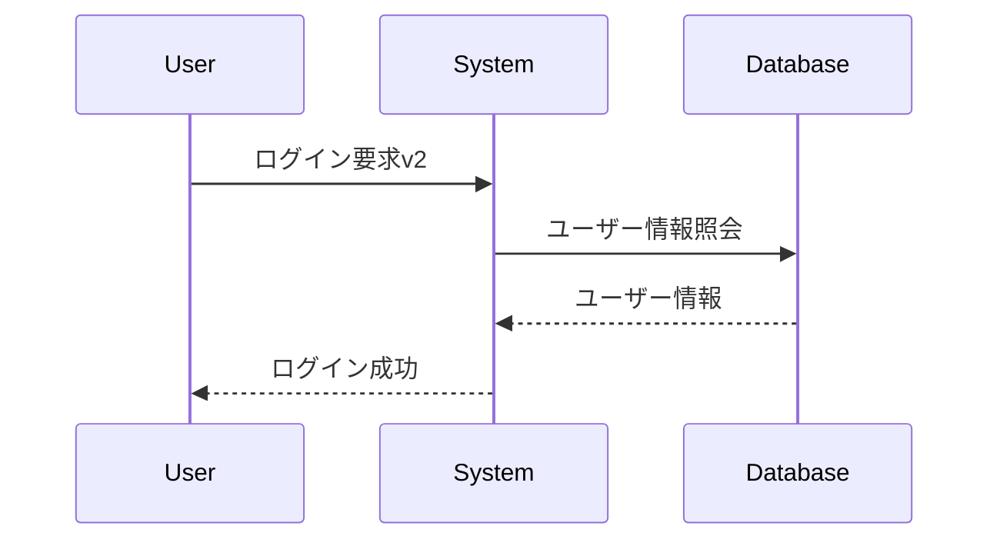
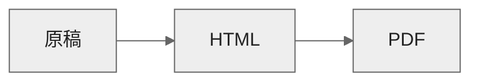

# Chapter 1　章タイトルv3

基本コンセプト
- その言語の魅力、面白さを伝えるsstt
- 内容はガチでも、デザインは柔らか

## 節タイトル - Start With Viliostyle
リード文。読者に話しかける感じで、この節で説明することを知ると、何ができるようになるのかを伝えてください。あああああああああああああああああああああああああああああああいああ


### モジュールを利用する - h3中見出し
#### datetimeクラスの利用 - h4小見出し
Chapter 4でオリジナルの関数をまとめたモジュールを作りましたが、実はPythonには、はじめから多数のモジュールが付属しています。これら**付属のモジュールを総称して「標準ライブラリ」と呼びます**。

標準ライブラリのモジュールを利用することで、プログラムでできることの範囲をさらに広げることができます。標準ライブラリはimport文でインポートするだけですぐに利用できます。

###### chap5-3-1 {.codenumber start-number=115}
```py
from datetime import date, timedelta
start = date( 2018, 6, 18 )    #←コメントの先頭を←にすると引き出し線に
for days in range(14):    #←繰り返しのfor文
    cur = start + timedelta( days=days )
    print( cur )
```

```console title=実行結果
2018/6/18
2018/6/18
2018/6/18
2018/6/18
```

複数のクラスをカンマ区切りで指定すると、まとめてインポートできます。

### 2週間分の日付の一覧を作る{.test}
開始日から2週間分の日付を表示するプログラムを書いてみましょう。「2週間分」のように複数のデータを作る場合、for文を使うことはすぐ思いつきます。ただし、dateオブジェクトだけで2週間分の日付を作ろうとするとうまくいきません。**その月の最終日を越えた日付、たとえば33日などを渡すと、バリューエラーが発生してしまうからです**。そこで、開始日のdateオブジェクトを作り、そこに経過日数のtimedeltaオブジェクトを加えて目的の日付を作ります。$x^2$

$$y=x^2+\frac{1}{3}\sqrt{2}$$

##### 標準ライブラリのモジュール（抜粋）

|モジュール名 |説明
|--|--
|csv |CSVファイルの読み込みと書き込みを行う
|datetime |日時を扱う
|json |Webでよく用いられるJSON形式のデータを扱う
|math |三角関数など数値計算用の関数がまとめられている
|pathlib |ファイルやフォルダの操作を行う
|random |乱数（デタラメに見える数）を生成する
|tkinter |GUIアプリケーションを作る
|zipfile |ZIP形式の圧縮ファイルを扱う

- 箇条書きああああああああああああああああああああああああああああああああああああああ
- 箇条書き
- 箇条書き
- 箇条書き

1. 番号付き箇条書き
1. 番号付き箇条書き
1. 番号付き箇条書き
1. 番号付き箇条書き

@div:figure

- ❶手順［I Agree］をクリック
- ❷手順［Cancel］をクリック
- ▶結果
@divend

##### コラム：コラムタイトル{.column}
開始日から2週間分の日付を表示するプログラムを書いてみましょう。「2週間分」のように複数のデータを作る場合、for文を使うことはすぐ思いつきます。ただし、dateオブジェクトだけで2週間分の日付を作ろうとするとうまくいきません。**その月の最終日を越えた日付、たとえば33日などを渡すと、バリューエラーが発生してしまうからです**。そこで、開始日のdateオブジェクトを作り、そこに経過日数のtimedeltaオブジェクトを加えて目的の日付を作ります。

#####

###### テスト用のちょっと長めのコード {.codenumber start-number=110}
```js
class MarkdownBookPreviewConvert {
  // markdownファイルを変換
  static convertMarkdown(mdpath, homepath) {
    const workdir = path.dirname(mdpath);

    //書き出しファイル名
    const htmlfilepath = mdpath.replace(".md", ".html");

    // ファイルを読み込み
    let src;
    try {
      src = fs.readFileSync(mdpath, "utf-8");
    } catch (err) {
      vscode.window.showErrorMessage("File Open Error" 
      + err.message);
      throw new Error("cannot open file.");
    }

    // 画像のsvg変換
    src = MarkdownBookPreviewConvert.svgimg(src, workdir);

    // vfmで変換
    // let html = marked(src);
    let html = stringify(src);

    // 強引な後処理 閉じpreの後に改行
    html = html.replace(/<\/pre>/g, "</pre>\n");

    // _postReplaceList.jsonがあれば後置換を実行
    try {
      const replisttext = fs.readFileSync(path.join(homepath, 
      "_postReplaceList.json"), "utf-8");
      const replist = JSON.parse(replisttext);
      for (let i = 0; i < replist.length; i++) {
        html = html.replace(new RegExp(replist[i].f, "g"), 
        replist[i].r);
      }
    } catch (err) {
      vscode.window.showInformationMessage("Replist Not Found" 
      + err.message);
      console.log("no replist");
    }
  }
}
```






```drawio
<mxfile>
  <diagram id="4jbJHTnvLfKHRbDQdqu1" name="ページ-1">
    <mxGraphModel dx="609" dy="627" grid="1" gridSize="10" guides="1" tooltips="0" connect="1" arrows="1" fold="1" page="1" pageScale="1" pageWidth="827" pageHeight="1169" math="0" shadow="0">
      <root>
        <mxCell id="0" />
        <mxCell id="1" parent="0" />
        <UserObject label="" mermaidData="{&#xa;  &quot;data&quot;: &quot;sequenceDiagram\r\n    participant User\r\n    participant System\r\n    participant Database\r\n\r\n    User-&gt;&gt;System: ログイン要求\r\n    System-&gt;&gt;Database: ユーザー情報照会\r\n    Database--&gt;&gt;System: ユーザー情報\r\n    System--&gt;&gt;User: ログイン成功&quot;,&#xa;  &quot;config&quot;: null&#xa;}" id="9">
          <mxCell connectable="0" parent="1" style="group;transparentBounds=1;editIcon=1;lockedGroup=0;groupPadding=10;" vertex="1">
            <mxGeometry as="geometry" />
          </mxCell>
        </UserObject>
        <UserObject label="User" mermaidId="n:User" mermaidBaseStyle="html=1;shape=umlLifeline;perimeter=lifelinePerimeter;whiteSpace=wrap;container=1;dropTarget=0;collapsible=0;recursiveResize=0;outlineConnect=0;portConstraint=eastwest;newEdgeStyle={&quot;edgeStyle&quot;:&quot;elbowEdgeStyle&quot;,&quot;elbow&quot;:&quot;vertical&quot;,&quot;curved&quot;:0,&quot;rounded&quot;:0};lifelineDashed=0;strokeWidth=2;rounded=1;absoluteArcSize=1;arcSize=6;lifelineColor=light-dark(#9370DB,#cccccc);size=65;lifelineMirror=1;fillColor=light-dark(#ECECFF,#1f2020);strokeColor=light-dark(#9370DB,#cccccc);fontColor=light-dark(#333333,#cccccc);fontFamily=Trebuchet MS,Verdana,Arial,sans-serif;fontSize=16;" mermaidBaseValue="User" id="2">
          <mxCell parent="9" style="html=1;shape=umlLifeline;perimeter=lifelinePerimeter;whiteSpace=wrap;container=1;dropTarget=0;collapsible=0;recursiveResize=0;outlineConnect=0;portConstraint=eastwest;newEdgeStyle={&quot;edgeStyle&quot;:&quot;elbowEdgeStyle&quot;,&quot;elbow&quot;:&quot;vertical&quot;,&quot;curved&quot;:0,&quot;rounded&quot;:0};lifelineDashed=0;strokeWidth=2;rounded=1;absoluteArcSize=1;arcSize=6;lifelineColor=light-dark(#9370DB,#cccccc);size=65;lifelineMirror=1;fillColor=light-dark(#ECECFF,#1f2020);strokeColor=light-dark(#9370DB,#cccccc);fontColor=light-dark(#333333,#cccccc);fontFamily=Trebuchet MS,Verdana,Arial,sans-serif;fontSize=16;" vertex="1">
            <mxGeometry height="326" width="150" x="10" y="10" as="geometry" />
          </mxCell>
        </UserObject>
        <UserObject label="System" mermaidId="n:System" mermaidBaseStyle="html=1;shape=umlLifeline;perimeter=lifelinePerimeter;whiteSpace=wrap;container=1;dropTarget=0;collapsible=0;recursiveResize=0;outlineConnect=0;portConstraint=eastwest;newEdgeStyle={&quot;edgeStyle&quot;:&quot;elbowEdgeStyle&quot;,&quot;elbow&quot;:&quot;vertical&quot;,&quot;curved&quot;:0,&quot;rounded&quot;:0};lifelineDashed=0;strokeWidth=2;rounded=1;absoluteArcSize=1;arcSize=6;lifelineColor=light-dark(#9370DB,#cccccc);size=65;lifelineMirror=1;fillColor=light-dark(#ECECFF,#1f2020);strokeColor=light-dark(#9370DB,#cccccc);fontColor=light-dark(#333333,#cccccc);fontFamily=Trebuchet MS,Verdana,Arial,sans-serif;fontSize=16;" mermaidBaseValue="System" id="3">
          <mxCell parent="9" style="html=1;shape=umlLifeline;perimeter=lifelinePerimeter;whiteSpace=wrap;container=1;dropTarget=0;collapsible=0;recursiveResize=0;outlineConnect=0;portConstraint=eastwest;newEdgeStyle={&quot;edgeStyle&quot;:&quot;elbowEdgeStyle&quot;,&quot;elbow&quot;:&quot;vertical&quot;,&quot;curved&quot;:0,&quot;rounded&quot;:0};lifelineDashed=0;strokeWidth=2;rounded=1;absoluteArcSize=1;arcSize=6;lifelineColor=light-dark(#9370DB,#cccccc);size=65;lifelineMirror=1;fillColor=light-dark(#ECECFF,#1f2020);strokeColor=light-dark(#9370DB,#cccccc);fontColor=light-dark(#333333,#cccccc);fontFamily=Trebuchet MS,Verdana,Arial,sans-serif;fontSize=16;" vertex="1">
            <mxGeometry height="326" width="150" x="210" y="10" as="geometry" />
          </mxCell>
        </UserObject>
        <UserObject label="Database" mermaidId="n:Database" mermaidBaseStyle="html=1;shape=umlLifeline;perimeter=lifelinePerimeter;whiteSpace=wrap;container=1;dropTarget=0;collapsible=0;recursiveResize=0;outlineConnect=0;portConstraint=eastwest;newEdgeStyle={&quot;edgeStyle&quot;:&quot;elbowEdgeStyle&quot;,&quot;elbow&quot;:&quot;vertical&quot;,&quot;curved&quot;:0,&quot;rounded&quot;:0};lifelineDashed=0;strokeWidth=2;rounded=1;absoluteArcSize=1;arcSize=6;lifelineColor=light-dark(#9370DB,#cccccc);size=65;lifelineMirror=1;fillColor=light-dark(#ECECFF,#1f2020);strokeColor=light-dark(#9370DB,#cccccc);fontColor=light-dark(#333333,#cccccc);fontFamily=Trebuchet MS,Verdana,Arial,sans-serif;fontSize=16;" mermaidBaseValue="Database" id="4">
          <mxCell parent="9" style="html=1;shape=umlLifeline;perimeter=lifelinePerimeter;whiteSpace=wrap;container=1;dropTarget=0;collapsible=0;recursiveResize=0;outlineConnect=0;portConstraint=eastwest;newEdgeStyle={&quot;edgeStyle&quot;:&quot;elbowEdgeStyle&quot;,&quot;elbow&quot;:&quot;vertical&quot;,&quot;curved&quot;:0,&quot;rounded&quot;:0};lifelineDashed=0;strokeWidth=2;rounded=1;absoluteArcSize=1;arcSize=6;lifelineColor=light-dark(#9370DB,#cccccc);size=65;lifelineMirror=1;fillColor=light-dark(#ECECFF,#1f2020);strokeColor=light-dark(#9370DB,#cccccc);fontColor=light-dark(#333333,#cccccc);fontFamily=Trebuchet MS,Verdana,Arial,sans-serif;fontSize=16;" vertex="1">
            <mxGeometry height="326" width="150" x="410" y="10" as="geometry" />
          </mxCell>
        </UserObject>
        <UserObject label="ログイン要求" mermaidId="e:User-&gt;System#0" mermaidBaseStyle="endArrow=block;endSize=9;verticalAlign=bottom;edgeStyle=elbowEdgeStyle;elbow=vertical;curved=0;rounded=0;fontSize=16;labelBackgroundColor=none;strokeWidth=1.5;strokeColor=light-dark(#333333,#cccccc);fontColor=light-dark(#333333,#cccccc);fontFamily=Trebuchet MS,Verdana,Arial,sans-serif;" mermaidBaseValue="ログイン要求" id="5">
          <mxCell edge="1" parent="9" source="2" style="endArrow=block;endSize=9;verticalAlign=bottom;edgeStyle=elbowEdgeStyle;elbow=vertical;curved=0;rounded=0;fontSize=16;labelBackgroundColor=none;strokeWidth=1.5;strokeColor=light-dark(#333333,#cccccc);fontColor=light-dark(#333333,#cccccc);fontFamily=Trebuchet MS,Verdana,Arial,sans-serif;" target="3">
            <mxGeometry relative="1" as="geometry">
              <Array as="points">
                <mxPoint x="185" y="119" />
              </Array>
              <mxPoint x="85" y="119" as="sourcePoint" />
              <mxPoint x="285" y="119" as="targetPoint" />
            </mxGeometry>
          </mxCell>
        </UserObject>
        <UserObject label="ユーザー情報照会" mermaidId="e:System-&gt;Database#0" mermaidBaseStyle="endArrow=block;endSize=9;verticalAlign=bottom;edgeStyle=elbowEdgeStyle;elbow=vertical;curved=0;rounded=0;fontSize=16;labelBackgroundColor=none;strokeWidth=1.5;strokeColor=light-dark(#333333,#cccccc);fontColor=light-dark(#333333,#cccccc);fontFamily=Trebuchet MS,Verdana,Arial,sans-serif;" mermaidBaseValue="ユーザー情報照会" id="6">
          <mxCell edge="1" parent="9" source="3" style="endArrow=block;endSize=9;verticalAlign=bottom;edgeStyle=elbowEdgeStyle;elbow=vertical;curved=0;rounded=0;fontSize=16;labelBackgroundColor=none;strokeWidth=1.5;strokeColor=light-dark(#333333,#cccccc);fontColor=light-dark(#333333,#cccccc);fontFamily=Trebuchet MS,Verdana,Arial,sans-serif;" target="4">
            <mxGeometry relative="1" as="geometry">
              <Array as="points">
                <mxPoint x="385" y="163" />
              </Array>
              <mxPoint x="285" y="163" as="sourcePoint" />
              <mxPoint x="485" y="163" as="targetPoint" />
            </mxGeometry>
          </mxCell>
        </UserObject>
        <UserObject label="ユーザー情報" mermaidId="e:Database-&gt;System#0" mermaidBaseStyle="dashed=1;fixDash=1;dashPattern=3 3;endArrow=block;endSize=9;verticalAlign=bottom;edgeStyle=elbowEdgeStyle;elbow=vertical;curved=0;rounded=0;fontSize=16;labelBackgroundColor=none;strokeWidth=1.5;strokeColor=light-dark(#333333,#cccccc);fontColor=light-dark(#333333,#cccccc);fontFamily=Trebuchet MS,Verdana,Arial,sans-serif;" mermaidBaseValue="ユーザー情報" id="7">
          <mxCell edge="1" parent="9" source="4" style="dashed=1;fixDash=1;dashPattern=3 3;endArrow=block;endSize=9;verticalAlign=bottom;edgeStyle=elbowEdgeStyle;elbow=vertical;curved=0;rounded=0;fontSize=16;labelBackgroundColor=none;strokeWidth=1.5;strokeColor=light-dark(#333333,#cccccc);fontColor=light-dark(#333333,#cccccc);fontFamily=Trebuchet MS,Verdana,Arial,sans-serif;" target="3">
            <mxGeometry relative="1" as="geometry">
              <Array as="points">
                <mxPoint x="385" y="207" />
              </Array>
              <mxPoint x="485" y="207" as="sourcePoint" />
              <mxPoint x="285" y="207" as="targetPoint" />
            </mxGeometry>
          </mxCell>
        </UserObject>
        <UserObject label="ログイン成功" mermaidId="e:System-&gt;User#0" mermaidBaseStyle="dashed=1;fixDash=1;dashPattern=3 3;endArrow=block;endSize=9;verticalAlign=bottom;edgeStyle=elbowEdgeStyle;elbow=vertical;curved=0;rounded=0;fontSize=16;labelBackgroundColor=none;strokeWidth=1.5;strokeColor=light-dark(#333333,#cccccc);fontColor=light-dark(#333333,#cccccc);fontFamily=Trebuchet MS,Verdana,Arial,sans-serif;" mermaidBaseValue="ログイン成功" id="8">
          <mxCell edge="1" parent="9" source="3" style="dashed=1;fixDash=1;dashPattern=3 3;endArrow=block;endSize=9;verticalAlign=bottom;edgeStyle=elbowEdgeStyle;elbow=vertical;curved=0;rounded=0;fontSize=16;labelBackgroundColor=none;strokeWidth=1.5;strokeColor=light-dark(#333333,#cccccc);fontColor=light-dark(#333333,#cccccc);fontFamily=Trebuchet MS,Verdana,Arial,sans-serif;" target="2">
            <mxGeometry relative="1" as="geometry">
              <Array as="points">
                <mxPoint x="185" y="251" />
              </Array>
              <mxPoint x="285" y="251" as="sourcePoint" />
              <mxPoint x="85" y="251" as="targetPoint" />
            </mxGeometry>
          </mxCell>
        </UserObject>
      </root>
    </mxGraphModel>
  </diagram>
</mxfile>

```
vmtt